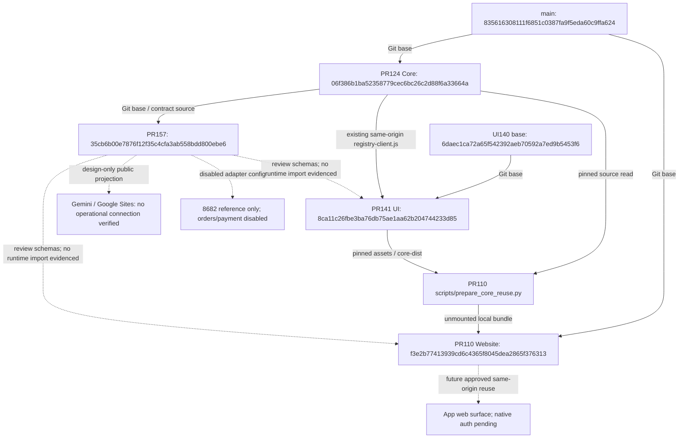

# CFP+ Issue #156 • Review handoff

**HOLD ACTIVATION • PRODUCTION NO-GO**

**Đầu mối hiện hành:** [bảng kiểm kê thống nhất 17 file](#kiểm-kê-thống-nhất--19102026)
và verification receipt trong manifest. Các đoạn bàn giao ban đầu dưới đây giữ
nguyên phạm vi lịch sử; verification mới không phải runtime acceptance.

- `openapi.json`: OpenAPI 3.1, existing Core list/detail and disabled public design.
- `API_CONTRACT.md`: integration, security review, adapters, rollback and blockers.
- `REGISTRY_MAPPING.md`: original Registry comparison and conflicts.
- `adapters.json`: five disabled read-only connection designs.
- `publication_policy.py`: offline policy reference; no signature verifier or endpoint.
- `test-results.txt`, `manifest.json`: reproducible offline results/source hashes.
- `source-observations.json`: pinned read-only evidence, not a runtime Registry.
- `FINDING_CLOSURE.md`: per-finding SHA/Evidence/Severity/Owner/criteria/verdict.
- `GOVERNANCE_DECISION_PACKET.md`: identity evidence requiring Human decision.

Run from this directory with Python 3 and requirements-test.txt installed:

```sh
python -m unittest -v test_findings
```

Historical 25-check baseline is pinned in test-results.txt; it was not rerun for this delta.
Targeted remediation checks and scope are in findings-test-results.txt / FINDING_CLOSURE.md. No runtime HTTP, live adapter, device test, formal OpenAPI
semantic lint or independent Gemini/Codex 2 acceptance claimed. All sample approval
receipts use example.invalid and are synthetic, never Governance authority.

## Kiểm kê thống nhất • 19/10/2026

Phần trên giữ nguyên bàn giao lịch sử. Phần này là bảng kiểm kê duy nhất của
17 file tại **`35cb6b00e7876f12f35c4cfa3ab558bdd800ebe6`** (H dưới đây),
không phải bản kê toàn bộ repository. Đã đối chiếu tree đầy đủ và danh sách
17 file added của PR157 so với Core base
`06f386b1ba52358779cec6bc26c2d88f6a33664a`.
Không có AGENTS.md trong tree H. Bản cập nhật này chỉ bổ sung README và
manifest; giữ nguyên 15 payload còn lại, logs cũ và toàn bộ lịch sử.
SHA commit kiểm kê được ghim trong comment bàn giao PR157/Issue156;
không nhúng SHA tự tham chiếu vào chính nội dung commit.

Trạng thái PASS dưới đây luôn có phạm vi: kiểm tra bytes, schema hoặc offline;
không phải runtime, external reviewer acceptance hay quyền kích hoạt.
Owner là phân công theo work order, không phải ACK đã nhận việc.
Đường dẫn tương đối trong bảng đều thuộc `contracts/issue156/`; mỗi Evidence
link ghim H. Các Git blob SHA đầy đủ và logs lần chạy mới nằm trong
`manifest.json` → `inventoryVerification`; manifest không tự hash chính nó.

| File / nhóm | Chức năng thực tế | SHA / phiên bản | Phụ thuộc / bên sử dụng | Evidence / kiểm tra | Trạng thái sử dụng | Owner | Finding / còn thiếu | Việc tiếp theo / trùng lặp |
|---|---|---|---|---|---|---|---|---|
| [openapi.json](https://github.com/charityfundplus/CFP.plus/blob/35cb6b00e7876f12f35c4cfa3ab558bdd800ebe6/contracts/issue156/openapi.json) • A | 4 GET operations: 2 Core list/detail hiện hữu, 2 public projection đề xuất; schema nội bộ và public tách biệt | H; OAS 3.1.0, draft | Tests, policy PublishedRecord, client/type generator tương lai; không được Core tự load | Blob/SHA256 khớp; OpenAPIV31SpecValidator 0.7.2: 0 lỗi | Contract dùng offline; public DESIGN_ONLY_DISABLED | Codex1; Codex2 QA; Claude review | F12 semantic PASS; real handler compatibility NOT VERIFIED; schema không thực thi auth | Dùng lại CorePage/CoreDetail cho review client; giữ schema public riêng, không tạo API thứ hai |
| [API_CONTRACT.md](https://github.com/charityfundplus/CFP.plus/blob/35cb6b00e7876f12f35c4cfa3ab558bdd800ebe6/contracts/issue156/API_CONTRACT.md) • A | Security/integration requirements, retry, pagination, error semantics, rollback/blockers | H; tài liệu draft | OpenAPI, policy, adapter; Website/App/Gemini implementers | Bytes/hash PASS; đối chiếu source Core và client tại pin | Hướng dẫn thiết kế, không middleware | Codex1; Claude/GrokSI review | F01–F10 runtime controls chưa được chứng minh | Giữ chi tiết kỹ thuật ở đây; README chỉ inventory; dùng verification mới bên dưới thay giới hạn validator lịch sử |
| [publication_policy.py](https://github.com/charityfundplus/CFP.plus/blob/35cb6b00e7876f12f35c4cfa3ab558bdd800ebe6/contracts/issue156/publication_policy.py) • A | project(), published_page(), digest(), retry_delay(); lọc, hash, expiry/revision và approval pin offline | H; Python helper | jsonschema; openapi.json; test_contract/test_findings | 20 contract + 16 finding tests PASS | Mã thực thi offline, không endpoint/signature verifier | Codex1/security; Codex2 QA | F01 tin input signatureVerified; chưa xác minh issuer/revocation/link disclosure; F06–F10 chưa có runtime/limits/canonical standard | Tái dùng thuật toán và negative cases sau security review; không mount helper như authenticator; giữ signed bytes/canonicalization gate |
| [REGISTRY_MAPPING.md](https://github.com/charityfundplus/CFP.plus/blob/35cb6b00e7876f12f35c4cfa3ab558bdd800ebe6/contracts/issue156/REGISTRY_MAPPING.md) • B | So sánh nguồn, các ID/Parent/coverage conflict; không cấp binding | H; evidence mapping draft | source-observations + governance-source-evidence; Governance/reviewers | Hash PASS; 5 source tests; 10 raw source observations readback khớp | Tài liệu review, không Registry runtime | Registry custodian/Human Governance; Perplexity đối chiếu | F14 BLOCKED: 69110/69118, VN, thiếu chain | Giữ mapping tại đây; decision packet dẫn về mapping, không nhân bản bảng; không sửa ID |
| [GOVERNANCE_DECISION_PACKET.md](https://github.com/charityfundplus/CFP.plus/blob/35cb6b00e7876f12f35c4cfa3ab558bdd800ebe6/contracts/issue156/GOVERNANCE_DECISION_PACKET.md) • B | Hồ sơ nguồn và các câu hỏi cần quyết định | H; packet chưa được phê duyệt | Mapping + raw evidence; Human Governance | Hash/readback PASS, không decision receipt | Hồ sơ chờ review | Human Governance; custodian; Perplexity/GrokSI | F14; source precedence/authority chưa quyết định | Bổ sung decision có authority vào hồ sơ hiện hữu; giữ tách evidence khỏi quyết định |
| [governance-source-evidence.json](https://github.com/charityfundplus/CFP.plus/blob/35cb6b00e7876f12f35c4cfa3ab558bdd800ebe6/contracts/issue156/governance-source-evidence.json) • B | 5 raw source snapshots + revision/blob; bổ sung trang CFP+AI69110 và holding manifest | H; nguồn ghim 652dd252cf37a3a4991f8bc9abf52b99abce68d0 | Decision packet, mapping, reviewers | 5/5 source content + blob readbacks PASS | Evidence snapshot, không roster hoặc live sync | Codex1 provenance; custodian | Empty 69110/69118 blobs không chứng minh binding | Trùng 6984.md với source-observations nhưng khác revision; giữ cả hai để bảo toàn provenance |
| [source-observations.json](https://github.com/charityfundplus/CFP.plus/blob/35cb6b00e7876f12f35c4cfa3ab558bdd800ebe6/contracts/issue156/source-observations.json) • B | Bundled observations: tree flags, paths, entity/country rows và 5 raw source texts | H; main/Core/Gemini pins lịch sử | test_sources, mapping | 5/5 tests PASS; 5 raw texts/blob readbacks PASS; tree flags là dữ liệu lịch sử | Evidence/test input, không source of truth mới | Codex1; Codex2; Perplexity đối chiếu | Tests đọc snapshot không chứng minh tree/roster hiện hành; Gemini package chưa reconciled | Dùng lại nguồn ghim; lần refresh phải ghi revision mới; không coi 26 entities là roster91 |
| [adapters.json](https://github.com/charityfundplus/CFP.plus/blob/35cb6b00e7876f12f35c4cfa3ab558bdd800ebe6/contracts/issue156/adapters.json) • C | 5 slot US/VN HSTDN, Chi Hội, 8682, 8882; GET-only, enabled=false, null endpoint/credential/owner | H; DESIGN_ONLY_DISABLED | Contract + test_adapter_hold; chưa thấy loader/transport trong Core được đọc | Hash và hold test PASS; 5/5 vẫn disabled | Cấu hình thiết kế, không connector đang chạy | Codex1; owner từng adapter cần xác minh | F02/F03: machine identity, scoped upstream credentials/SSRF/denied writes chưa triển khai; retryAfterMaxSeconds30 vs helper5 cần thống nhất | Tái dùng shape; review từng slot riêng, không bật adapter hay điền endpoint suy đoán |
| [test_contract.py](https://github.com/charityfundplus/CFP.plus/blob/35cb6b00e7876f12f35c4cfa3ab558bdd800ebe6/contracts/issue156/test_contract.py) • D | 20 schema/policy/retry/hold tests; fixture synthetic và validate helper dùng chung | H; baseline tests giữ nguyên | policy, OAS, adapters, jsonschema | 20/20 trong rerun41 PASS | Test code chạy local, không HTTP | Codex2 QA; Codex1 fixes | Approval fixture tự gắn boolean; không chứng minh signature/real authorization | Dùng chung fixture với test_findings; bổ sung actual-handler suite riêng trong phạm vi được duyệt |
| [test_findings.py](https://github.com/charityfundplus/CFP.plus/blob/35cb6b00e7876f12f35c4cfa3ab558bdd800ebe6/contracts/issue156/test_findings.py) • D | 16 regressions cho public states/Evidence, pins, expiry/revocation/renewal mô phỏng | H; offline remediation tests | test_contract.fixture/validate + policy | 16/16 trong rerun41 PASS | Test code offline | Codex2 QA; Codex1 fixes | Revocation giả lập bằng thay receipt; không revocation service | Giữ negative cases; không đổi nhãn thành security runtime PASS |
| [test_sources.py](https://github.com/charityfundplus/CFP.plus/blob/35cb6b00e7876f12f35c4cfa3ab558bdd800ebe6/contracts/issue156/test_sources.py) • D | 5 checks về conflict, missing chain, counts trên snapshot | H; baseline tests giữ nguyên | source-observations.json | 5/5 trong rerun41 PASS | Snapshot checks | Codex2; Perplexity/custodian review | Không independently validate entire upstream tree/authority | Dùng lại; source readbacks bổ sung provenance, không đóng Governance |
| [test-results.txt](https://github.com/charityfundplus/CFP.plus/blob/35cb6b00e7876f12f35c4cfa3ab558bdd800ebe6/contracts/issue156/test-results.txt) • D | Log baseline 25 checks (20 contract + 5 sources) | H bytes; execution lịch sử baseline652dd252 | manifest, closure, reviewers | Hash PASS; lần chạy mới41 ghi riêng trong manifest | Evidence lịch sử, không new HEAD runtime | Codex2 evidence | Không dùng log25 để cộng thêm vào41 | Giữ nguyên; không thay log cũ bằng lần chạy mới |
| [findings-test-results.txt](https://github.com/charityfundplus/CFP.plus/blob/35cb6b00e7876f12f35c4cfa3ab558bdd800ebe6/contracts/issue156/findings-test-results.txt) • D | Log 19 targeted = 16 finding + 3 affected contract checks | H; remediation execution lịch sử | manifest + closure | Hash PASS; 3 checks trùng contract suite | Evidence lịch sử | Codex2 evidence | 25+19 không phải44 tests độc lập; union là41 | Giữ nguyên, ghi rõ overlap; không sinh log cạnh tranh |
| [manifest.json](https://github.com/charityfundplus/CFP.plus/blob/35cb6b00e7876f12f35c4cfa3ab558bdd800ebe6/contracts/issue156/manifest.json) • D | 16 payload SHA256, source pins, command/result; nay thêm verification provenance | H bản kiểm kê; bản mới chỉ thêm receipt/refresh README hash | Tất cả16 payload; reviewers | H16/16 SHA256 và17/17 Git blobs PASS; manifest không tự hash | Metadata integrity, không signature/authority receipt | Codex2 evidence | CI chưa có run/check cho H; integrity không đồng nghĩa nội dung đúng | Một manifest hiện hữu; giữ historical fields, inventoryVerification ghi source pins và logs mới |
| [FINDING_CLOSURE.md](https://github.com/charityfundplus/CFP.plus/blob/35cb6b00e7876f12f35c4cfa3ab558bdd800ebe6/contracts/issue156/FINDING_CLOSURE.md) • D | Ledger 6 nhóm finding từ review trước, owner/criteria/verdict có giới hạn | H; candidate closure, chưa external accept | OAS/tests/mapping/decision packet | Hash PASS; ledger vẫn ghi semantic validator chưa có ở thời điểm cũ | Hồ sơ review, không final acceptance | Codex1; Codex2/Claude independent review | Không phải nguyên manifest Claude F01–F15; F11/F15 thiếu mô tả | Đính nguồn finding gốc trước đối chiếu số; không tự đánh số lại hoặc đóng finding |
| [README.md](https://github.com/charityfundplus/CFP.plus/blob/35cb6b00e7876f12f35c4cfa3ab558bdd800ebe6/contracts/issue156/README.md) • E | Entry point, bảng17 file thống nhất, dependency map và kế hoạch gates | H entry point lịch sử; bản kiểm kê bổ sung trong commit này | Dẫn tới contract/ledger/evidence, không được runtime load | H blob/hash PASS; bản mới hash trong manifest | Tài liệu quản lý dùng cho review | Codex2 inventory; Codex1 architecture | Tránh list cạnh tranh hoặc diễn giải design thành implemented | Duy trì bảng này; comment chỉ link, không nhân bản inventory |
| [requirements-test.txt](https://github.com/charityfundplus/CFP.plus/blob/35cb6b00e7876f12f35c4cfa3ab558bdd800ebe6/contracts/issue156/requirements-test.txt) • E | Pin jsonschema==4.26.0 | H; test dependency | Python test/policy | Hash PASS; local jsonschema4.26.0 | Dependency khai báo cho test, không lock toàn bộ môi trường | Codex2 QA | Chưa khai báo OAS validator; Python/platform/transitives không locked | Receipt ghi validator0.7.2 riêng; thống nhất dependency pin ở đợt QA tiếp theo |

### Sơ đồ phụ thuộc đã đối chiếu

Các cạnh Git base khác với phụ thuộc source hoặc phụ thuộc review. PR157 dựa
trực tiếp trên Core124. PR141 dựa trên nhánh UI140, không dựa trên157.
PR110 và124 cùng base main; PR110 lấy source141/124 theo pin, không phải đã merge.



Source đã đọc: [PR110 preparation script](https://github.com/charityfundplus/CFP.plus/blob/f3e2b77413939cd6c4365f8045dea2865f376313/scripts/prepare_core_reuse.py),
[PR110 handoff](https://github.com/charityfundplus/CFP.plus/blob/f3e2b77413939cd6c4365f8045dea2865f376313/docs/website-core-reuse-20261018/HANDOFF_VI.md),
[PR141 README](https://github.com/charityfundplus/CFP.plus/blob/8ca11c26fbe3ba76db75ae1aa62b204744233d85/hub69/ui/README.md),
[Core client](https://github.com/charityfundplus/CFP.plus/blob/06f386b1ba52358779cec6bc26c2d88f6a33664a/drafts/si-office/public/registry-client.js),
[Core HTTP](https://github.com/charityfundplus/CFP.plus/blob/06f386b1ba52358779cec6bc26c2d88f6a33664a/drafts/si-office/sandbox/p2-http.mjs),
[Core service](https://github.com/charityfundplus/CFP.plus/blob/06f386b1ba52358779cec6bc26c2d88f6a33664a/drafts/si-office/sandbox/p2-service.mjs).
Các kết quả6/6 loopback từ PR110/141 là evidence lịch sử của các PR đó, không
phải lần chạy mới hoặc chứng minh PR157 đã được mount.

### Tái sử dụng và loại trừ công việc trùng

- Sẵn sàng **review tích hợp**: CorePage/CoreDetail và exact numeric-string IDs;
  existing same-origin Core client/auth/provenance/error handling; UI141
  core-dist với records rỗng khi bootstrap; script prepare_core_reuse.py của110;
  public-only schema, offline pagination/Evidence negative tests và source pins.
  Đây là readiness để review, không phải approval sử dụng production.
- Không tạo client, backend, Registry, UI bundle hoặc inventory thứ hai.
  API_CONTRACT giữ yêu cầu bảo mật; FINDING_CLOSURE giữ closure; mapping giữ
  so sánh; packet giữ câu hỏi quyết định; manifest giữ hashes/log provenance.
- Source snapshots trùng một phần là intentional evidence ở revision khác nhau.
  Không xóa/hợp nhất raw source hoặc log lịch sử. Có thể giảm phần văn bản lặp
  bằng link trong đợt biên tập sau; không có dữ liệu nào bị xóa ở lượt này.
- 25 baseline và19 targeted có3 checks trùng. Rerun toàn bộ là41 =20+16+5,
  không44 và không cộng số test từ PR khác để tuyên bố coverage end-to-end.
- Đối chiếu SHA-256 toàn bộ17 file tại H không có cặp file trùng byte. Năm
  adapter có cùng policy fields ngoài key/label/referenceIDs, nhưng vẫn là5
  slot tham chiếu khác nhau. Có thể review shared policy khi triển khai transport;
  không gộp slot, xóa snapshot hoặc refactor config trong lượt kiểm kê.

### Evidence mới và giới hạn

Python3.12.14/Linux; jsonschema4.26.0; openapi-spec-validator0.7.2 được cài
riêng vào `/tmp/cfp-validator`. Exact17 file lấy qua GitHub connector tại H,
đối chiếu SHA1 Git blob với tree đầy đủ trước kiểm kê. SHA25616 payload khớp
manifest H. 10 raw source observations đọc lại đúng source revision và blob,
không chứng minh toàn bộ roster/authority hoặc mọi tree claim lịch sử.

```sh
python -m unittest -v test_contract test_findings test_sources
PYTHONPATH=/tmp/cfp-validator python -c "import json; from openapi_spec_validator import OpenAPIV31SpecValidator; errors=list(OpenAPIV31SpecValidator(json.load(open('openapi.json'))).iter_errors()); print(errors); assert not errors"
```

Kết quả:41/41 PASS,0 FAIL; full OAS3.1 semantic validator:0 errors. Chi tiết
execution output, source pins/blob hashes và verification nằm trong manifest
hiện hữu. Lần chạy này không sửa tests/policy/OAS hoặc logs lịch sử.
OAS semantic PASS không chứng minh HTTP response conformance hay authz.
GitHub Actions cho H: wrapper PR workflow_runs trả []; check-runs endpoint trả
total_count=0. Không có CI PASS được xác nhận tại H; đây là local execution.

### Khoảng trống và thứ tự kiểm thử / nghiệm thu

1. **P0 • source/finding provenance:** lấy nguyên manifest Claude F01–F15;
   handoff [6259232156](https://github.com/charityfundplus/CFP.plus/pull/157#issuecomment-6259232156)
   ghi thiếu F11/F15; review cũ6259118869 dùng numbering khác. Không tự map
   identity collision thành security F01. Claude/GrokSI/Perplexity/Gemini
   được mời review theo phân công, receipt của họ vẫn NOT VERIFIED.
2. **P0 • Governance:** custodian + Human Governance quyết định nguồn cho
   CFP+AI69110/OpenAI69118/CoreWeave, Vietnam984/6984 Parent/coverage và
   chain6→69→696→6969. Perplexity đối chiếu, không tự đổi Registry/ID/Parent/DID.
   Decision packet hiện hữu là nơi tiếp nhận quyết định có authority.
3. **P0 • security:** Codex1 + Claude review server-owned signature/issuer,
   revocation snapshot, per-field/link disclosure và audit fail-closed; dedicated
   machine identity/scope, GET-only HTTPS allowlist/redirect/DNS/SSRF controls;
   privacy lỗi/counts/pins, bounded inputs/bytes/timeout/rate và canonical hash
   cross-language. `signatureVerified=True` synthetic không phải approval.
   Core readRegistry ở pin xác thực account rồi đọc references; chưa thấy gate
   `registry.read` riêng hoặc Registry read rate limit, mỗi read ghi audit.
   F04 least-privilege/audit-flood defense chưa đủ evidence. Session expiry,
   logout, Host/Origin/cookie có source, nhưng F05 adversarial runtime chưa chạy.
   **LOW/P3 còn OPEN — malformed approval receipt:** review tại đúng H
   [6269905599](https://github.com/charityfundplus/CFP.plus/pull/157#issuecomment-6269905599)
   ghi expiresAt=None/int gây AttributeError, fields=None/mixed list gây TypeError;
   published_page chỉ bắt ValueError/ValidationError nên có thể làm hỏng cả page.
   Đối chiếu source H xác nhận khoảng trống kiểm kiểu; đây là robustness fail-closed,
   không phải bằng chứng disclosure/live exploit. **Owner: Codex1; Codex2 kiểm tra**.
   **Closure:** xác minh expiresAt là string, fields là list[str], chuẩn hóa lỗi;
   negative tests chứng minh receipt sai bị loại, record hợp lệ vẫn được trả và
   pagination fail-closed. Chưa sửa policy hoặc đóng finding trong kiểm kê này;
   không tự gán LOW này vào mã Claude F01–F15 khi thiếu original manifest.
4. **P1 • actual Core handler contract:** Codex2 chạy Core124 pinned handler
   với SQLite/account synthetic trong thư mục tạm, validate200 CorePage/CoreDetail,
   401/400/404/409/503, duplicate query, source mismatch, revoke/audit failure;
   phân biệt public facade không mount. Kiểm ID81/256 digits và zero preservation:
   client detail chấp nhận256 nhưng projectCoreRecord từ chối display>80;
   không thay scope PR110/141 để đóng finding157. Reuse actual Core tests/harness,
   không tạo mock Core thay kiểm chứng. Lượt inventory này chưa chạy HTTP suite.
5. **P1 • integration review:** tái sử dụng preparation110 và bootstrap141,
   so sánh generated types với schemas mới; public types không dùng cho
   authenticated Core. Review mount allowlist/relative assets và same-origin
   App surface; native/cross-origin App auth cần contract riêng. Không đổi IAM.
6. **P2 • approved environment only:** owner/scope/HTTPS URL, deployed SHA,
   read-only source mount/account, rollback và origin/CORS được chỉ định trước
   HTTP/browser/Safari iPhone/readback. Google Sites thiếu preview/origin/access;
   8682/8882 thiếu owner, endpoint, identity/scope và output/readback. Giữ cả5
   adapter disabled; không order/payment/financial action.
7. **Acceptance:** Claude review lại exact commit+manifest; GrokSI phản biện
   reuse/assumptions; Perplexity reconcile nguồn; Gemini đánh giá Google integration.
   Chỉ ghi receipt/verdict khi họ thực sự cung cấp. Human Governance quyết định
   từng thành phần sau Evidence; offline/local PASS không tự đóng runtime findings.

**HOLD ACTIVATION • PRODUCTION NO-GO.** Không merge/publish/deploy, đổi IAM,
Registry, Canonical ID/Parent/DID hoặc kích hoạt adapter. PR157 giữ Draft;
PR110/124/141 không bị sửa. Human Governance retains final authority.
