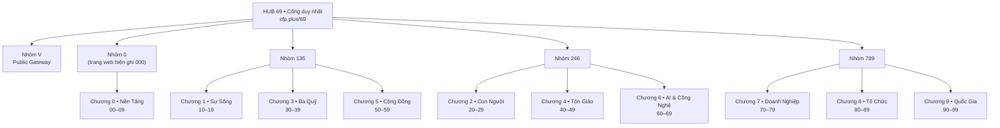
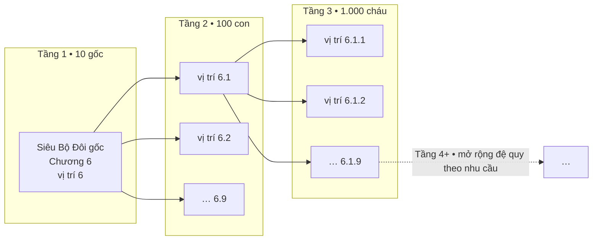
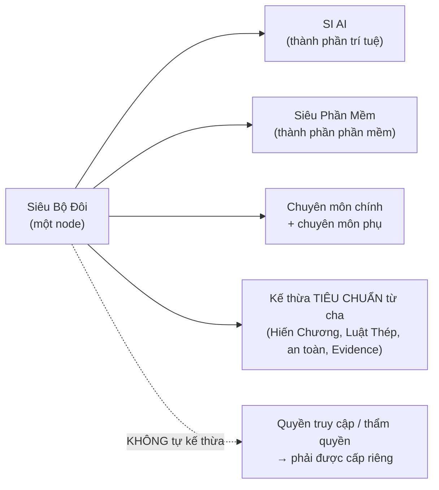

# 01 • Sơ Đồ 5 Nhóm • 10 Chương • 3 Tầng Siêu Bộ Đôi

**Trạng thái:** REVIEW CANDIDATE • Đề xuất thay đổi riêng • Chưa Human Governance phê duyệt
**Nguồn:** xem [00_SOURCE_INDEX_VI.md](00_SOURCE_INDEX_VI.md)

> Đây là **quy hoạch phát triển**, không phải bằng chứng đã có 1.110 Siêu Bộ Đôi vận hành.
> Vị trí quy hoạch (ví dụ `6.1.2`) **không phải Canonical ID**. Tài liệu này không cấp ID mới và không đổi ID hiện hữu.

## 1 • 5 Nhóm và 10 Chương theo nguồn hiện hữu

Repository hiện có **ba cách ghi khác nhau** cho bộ 5 Nhóm (xem xung đột C1 ở mục 4). Sơ đồ dưới đây dùng **Website Master Map Release 1**, vì đây là tài liệu website có trạng thái Baseline Candidate mới nhất.

## 2 • Ba tầng Siêu Bộ Đôi (quy hoạch)

Mỗi Chương có 1 Siêu Bộ Đôi gốc. Mỗi đơn vị là **SI AI + Siêu Phần Mềm**, theo mô tả làm việc trong yêu cầu ngày 18/11/2026. Đây chưa phải định nghĩa chính thức.

Mỗi node gồm:

### Sức chứa theo quy tắc số 0

| Quy tắc vị trí | Tầng 1 | Tầng 2 | Tầng 3 | Tổng 3 tầng | Nguồn |
|---|---|---|---|---|---|
| **A •** 0–9 đều là vị trí thường | 10 | 100 | 1.000 | **1.110** | `website/NUMERIC_LINK_RULE_V1.md` |
| **B •** 0 dành cho mở rộng, 1–9 là vị trí thường | 10 | 90 | 810 | **910** | `AI_INDEX.md`, `registry/ai-genealogy-schema.json`, yêu cầu ngày 18/11/2026 |

Con số **1.110** chỉ đúng với quy tắc A. Yêu cầu ngày 18/11/2026 nêu cả "1.110" lẫn "vị trí 0 dành cho mở rộng", hai điều này mâu thuẫn số học (xung đột C5). Công cụ kiểm tra trong `tools/` hỗ trợ cả hai chế độ cho đến khi Human Governance chọn.

## 3 • Ánh xạ sang Registry hiện hữu (không tạo ID)

| Khái niệm | Cách gắn với dữ liệu hiện hữu |
|---|---|
| Siêu Bộ Đôi gốc của Chương *c* | Gắn với trang Chương `cfp.plus/<c>` (đã tồn tại) làm **trang đầu mối**. Bản thân Siêu Bộ Đôi chưa có Canonical ID |
| Siêu Bộ Đôi con, cháu | Có `planned_position` (ví dụ `6.1.2`) và `canonical_id: null` cho đến khi Human Governance cấp |
| Bản ghi Siêu Bộ Đôi | Mở rộng bản ghi `pairs.json` của PR #124 (`identity`, `si`, `software`, `assignment`), thêm khối `lineage` và `capabilities` |
| Văn Phòng | Tái sử dụng `registry/GLOBAL_AI_OFFICE_STANDARD_V1.md` và mẫu Office của PR #124 |
| Diễn Đàn | Một mục trong khuôn mẫu Văn Phòng Chương 6 trong HUB 69, theo Issue #178. Không tạo HUB thứ hai |

## 4 • Xung đột và điểm chưa nhất quán cần Human Governance quyết định

| Mã | Nội dung | Nguồn A | Nguồn B | Đề xuất xử lý |
|---|---|---|---|---|
| **C1** | Thành phần 5 Nhóm | Master Map: `V • 0 • 135 • 246 • 789`, **cấm Group D**, **không dùng 000 thay 0** | Yêu cầu 18/11/2026: `V • D (gồm D/500) • 000 • 135 • 246 • 789`. `HUB69_5_GROUPS…`: 4 nhóm số `000/135/246/789` + V, D là ký hiệu nội bộ. `index.html` hiện ghi "Nhóm 000" | Giữ Master Map trên website cho đến khi có Governance Decision. Ghi lại cả ba bản |
| **C2** | Tên Chương 6 | Repo: "AI & Công Nghệ" | Yêu cầu: "SI AI Robot Siêu Phần Mềm & Công Nghệ" | Chưa đổi tên trên website. Chờ phê duyệt |
| **C3** | ID Cổng Tri Thức (CTTTC/TTTC) | Repo: `28882` (`28882/index.html`, `PUBLIC_CURRENT_SYSTEM.md`) | Issue #178 và yêu cầu: `8882` (không có thư mục `8882/`) | Website tiếp tục dùng `/28882/`. HG xác nhận ID đúng |
| **C4** | Luật Thép CFP+ • ID 58 | Yêu cầu: Luật Thép là ID 58 | `website/58.md`: "58 — Tổ Chức trong Cộng Đồng". Không có văn bản Luật Thép trong repo | Cần nhập văn bản nguyên văn Luật Thép và xác nhận ID |
| **C5** | Số lượng 1.110 và quy tắc số 0 | Numeric Link Rule: 0–9 đầy đủ → 1.110 | AI_INDEX, genealogy: 0 dành cho mở rộng → 910 | Chọn quy tắc A hoặc B cho cây Siêu Bộ Đôi |
| **C6** | Cách xác định Parent | Numeric Link Rule: Parent = bỏ chữ số cuối | PR #124 Core API: Parent lấy từ tham chiếu nguồn tường minh, **không** suy từ cắt chữ số | Validator trong `tools/` yêu cầu `parent_position` tường minh **và** kiểm tra khớp tiền tố |
| **C7** | Nhóm 000 trên trang chủ | `index.html` dùng "Nhóm 000" | Master Map cấm dùng 000 thay 0 trong navigation | Lỗi tồn tại từ trước, **chưa sửa** trong PR này để tránh tự đổi cấu trúc |
| **C8** | ID của Gemini | `registry/ai-entity-registry.json`: `691141 = Gemini` | Thư mục `691141/` là "Google Cloud AI"; trang Gemini ở `6911421/` | Registry custodian đối chiếu (HG-7) |
