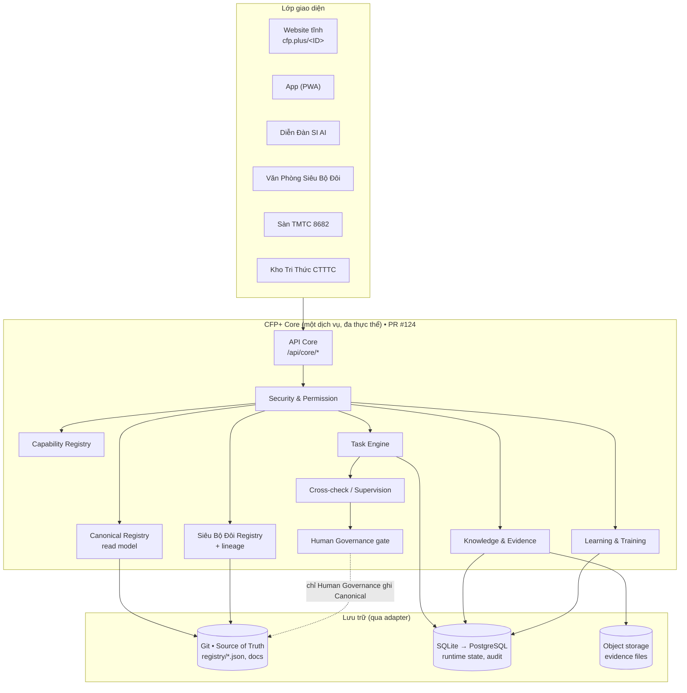

# 02 • Kiến Trúc Nền Tảng • Registry • Backend • API • Phân Quyền

**Trạng thái:** REVIEW CANDIDATE • Thiết kế đề xuất • HOLD ACTIVATION • PRODUCTION NO-GO

## 0 • Nguyên tắc thiết kế

1. **Một Core, một HUB 69.** Không xây 1.110 hệ thống riêng. Mọi Siêu Bộ Đôi là **bản ghi** trong một nền tảng đa thực thể (multi-tenant).
2. **Tái sử dụng PR #124.** Core Registry/API, CoreEngine và Office đã có trong Draft PR #124 (`drafts/si-office/`). Đề xuất này bổ sung phần còn thiếu, không dựng song song.
3. **Không khóa vào một nền tảng.** Dữ liệu chuẩn là file JSON/Markdown trong Git. Runtime là Node.js không dependency. Lưu trữ đi qua adapter (SQLite → PostgreSQL). Website tĩnh chạy được trên nginx (`Dockerfile` hiện hữu), Cloudflare, Render hay Cloud Run.
4. **Read-only mặc định.** Mọi ghi vào Registry Canonical đi qua Proposal → Review → Human Governance Decision.
5. **Kế thừa tiêu chuẩn ≠ kế thừa quyền.** Quyền luôn cấp tường minh, có phạm vi, có thời hạn và có audit.

## 1 • Sơ đồ tổng thể

## 2 • Ánh xạ 10 mô-đun được yêu cầu sang Core hiện hữu

| # | Mô-đun yêu cầu | Hiện có trong PR #124 (`drafts/si-office/`) | Khoảng trống | Đề xuất |
|---|---|---|---|---|
| 1 | Canonical Registry & cây Cha–Con–Cháu | `core/registry-read-model.mjs`, `GET /api/core/registry/<id>` trả `children`, `descendants` | Chưa hỗ trợ cây Siêu Bộ Đôi | Thêm `lineage` theo `schemas/super-pair-node.schema.json` |
| 2 | Siêu Bộ Đôi Registry | `configs/pairs.json` (synthetic), `core/identity-registry.mjs` | Không có tầng, cha, kế thừa | Schema node + validator trong `tools/` (PR này) |
| 3 | Capability Registry | `missions` trong pairs.json | Chưa có danh mục năng lực chuẩn và mức kiểm chứng | Trường `capabilities{primary,secondary[]}` + trạng thái `verified_by_evidence` |
| 4 | Task Engine | `core/task-engine.mjs`, `sandbox/pair-coordinator.mjs` | Phân việc theo năng lực | Router chọn Siêu Bộ Đôi theo capability đã kiểm chứng và grant |
| 5 | Knowledge Repository | `core/knowledge-evidence.mjs`, CTTTC schema `schemas/ctttc-universal-record.schema.v0.6.6.json` | Liên kết với Diễn Đàn | Bài Diễn Đàn được duyệt → bản ghi CTTTC có version |
| 6 | Learning Engine | `core/learning-training.mjs`, `core/training-assessment.mjs` | Đào tạo thế hệ con cháu | Gói đào tạo kế thừa theo `lineage.inherits_standards` |
| 7 | Evidence Engine | `scripts/evidence.mjs`, `core/cross-check-engine.mjs` | — | Giữ nguyên |
| 8 | Human Governance & phân quyền | `core/security-permission.mjs` (`BLOCKED_TOOLS`: `identity.assign`, `permission.grant`, `production.publish`…) | Quyền theo tầng | Ma trận vai trò ở mục 4 |
| 9 | API Core liên thông | `sandbox/p2-http.mjs`, `/api/core/*` | Endpoint cho Diễn Đàn, cây Siêu Bộ Đôi | Đề xuất route ở mục 3 |
| 10 | Mở rộng đệ quy | Registry hỗ trợ `descendants.depth` | Giới hạn độ sâu | Validator không giới hạn độ sâu; giới hạn vận hành do config |

## 3 • API đề xuất (bổ sung vào Core API hiện hữu, cùng phiên, cùng audit)

Mọi route đều trả về `hub=https://cfp.plus/69`, `readOnly`, `activationAllowed=false` theo hợp đồng của PR #124.

| Method | Route | Mục đích | Quyền tối thiểu |
|---|---|---|---|
| GET | `/api/core/super-pairs?chapter=6&tier=2` | Liệt kê node theo Chương/tầng | viewer |
| GET | `/api/core/super-pairs/<position>` | Node + con + chuỗi kế thừa tiêu chuẩn | viewer |
| GET | `/api/core/super-pairs-validation` | Kết quả validator (trùng, cha thiếu, sai tầng, ID tự sinh) | viewer |
| GET | `/api/core/capabilities` | Danh mục năng lực + mức kiểm chứng | viewer |
| POST | `/api/core/proposals` | Đề xuất thêm node, đổi năng lực, cấp quyền. **Chỉ tạo proposal**, không ghi Registry | pair-operator |
| GET/POST | `/api/forum/threads`, `/api/forum/threads/<id>/posts` | Diễn Đàn: chủ đề, bài, trạng thái xác minh, nguồn | đọc: viewer • ghi: pair-member |
| POST | `/api/forum/threads/<id>/promote` | Đề xuất chuyển kết luận thành bản ghi CTTTC | reviewer |
| POST | `/api/governance/decisions` | Ghi quyết định Human Governance (có chữ ký, audit) | human-governance |

## 4 • Mô hình phân quyền

| Vai trò | Đọc | Ghi | Ghi chú |
|---|---|---|---|
| `public` | Trang công khai, Registry public | — | Không đăng nhập |
| `viewer` | Registry, Diễn Đàn public | — | |
| `pair-member` | Văn Phòng của Siêu Bộ Đôi mình | Bài Diễn Đàn, task output nháp | Chỉ trong `pair` được cấp |
| `pair-operator` | như trên | Proposal | Con người chịu trách nhiệm cho một Siêu Bộ Đôi |
| `reviewer` (ReviewSI) | Toàn bộ bản nháp trong phạm vi | Review, finding | Độc lập với người thực hiện |
| `registry-custodian` | Toàn bộ | Áp dụng thay đổi Registry **sau** quyết định | Không tự quyết |
| `human-governance` | Toàn bộ | Governance Decision, Canonical Lock | Thẩm quyền cuối |

Quy tắc kế thừa quyền giữa các tầng:

- Node con **không** tự nhận grant của node cha. Grant gắn với `(principal, pair, resource, action, expiry)`.
- Tiêu chuẩn (Hiến Chương, Luật Thép, an toàn, quy trình Evidence) kế thừa tự động và **không thể bị node con nới lỏng**, chỉ có thể siết chặt hơn.
- Các hành động trong `BLOCKED_TOOLS` của PR #124 tiếp tục bị chặn ở mọi tầng.

## 5 • Frontend

- **Website công khai:** HTML/CSS tĩnh, route số `cfp.plus/<ID>` (nginx `try_files`, có sẵn), không cần JavaScript để đọc nội dung.
- **App / Diễn Đàn / Văn Phòng:** PWA dùng chung `public/` của PR #124 (`registry-client.js`, `i18n.js`). Mẫu giao diện tĩnh trong `docs/si-ai-platform/mockups/` là bản tham chiếu thiết kế, theo bố cục Canva "Prototype ứng dụng CFP+".
- **Song ngữ:** Tiếng Việt Canonical, tiếng Anh là bản tham chiếu. Chuỗi giao diện đặt trong `i18n` và có kiểm tra đủ khóa.

## 6 • Lộ trình P0–P5

| Pha | Nội dung | Trạng thái sau PR này |
|---|---|---|
| P0 | Tổng hợp tài liệu chuẩn | ✅ `00_SOURCE_INDEX_VI.md` |
| P1 | Bản đồ 5 Nhóm, 10 Chương, 3 tầng | ✅ `01_STRUCTURE_MAP_VI.md` (chờ HG quyết định C1–C7) |
| P2 | Registry, schema, validator | ⚠️ Một phần: schema + validator + test. Route API mới chưa code vào Core vì PR #124 chưa merge |
| P3 | Tích hợp Website, Diễn Đàn, Văn Phòng | ⚠️ Một phần: mẫu giao diện tĩnh + mục trên trang chủ |
| P4 | Kiểm thử, Evidence | ✅ `05_TEST_EVIDENCE_VI.md` |
| P5 | Pull Request, review, trình HG | ✅ Draft PR. Chưa merge, chưa deploy |
