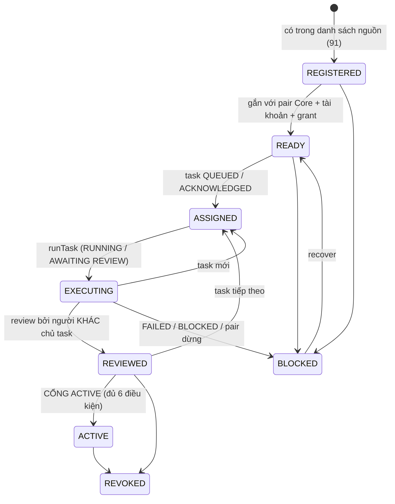

# 09 • ACK Riêng • Adapter READ ONLY • Tiến Trình Siêu Bộ Đôi • Kiểm Chứng Độc Lập

**Trạng thái:** REVIEW CANDIDATE • Bản vá đề xuất cho PR #124 (chưa áp vào nhánh PR #124) • Adapter **KHÔNG kích hoạt** • PRODUCTION NO-GO

## 1 • Đối chiếu bảng chuẩn hóa 91 Siêu Bộ Đôi (Notion, sửa 2026-11-18T23:22Z)

Nguồn: [Bảng Link ID Số 91 Siêu Bộ Đôi](https://app.notion.com/p/41ccaac9a55781e1a586e849a147641a). Ảnh chụp trong `data/notion-snapshots.json` → `bang_link_91`.

| Kiểm tra | Kết quả |
|---|---|
| Tập ID so với `super-pair-source-inventory.json` | **91/91 trùng khớp**, không thừa, không thiếu |
| URL hồ sơ Notion | **89/89 trùng khớp**; 2273, 2588 vẫn PENDING ở cả hai nơi |
| Tên | **91/91 trùng khớp** |
| Tiêu đề trang được liên kết so với tên | **3 khác biệt**: **333** (tên "Quỹ Đầu Tư", trang "Tài Chính & Ba Quỹ"); **4742** (trang rút gọn "Hiến Pháp, Hiến Chương & Luật Thép"); **5284** (tên "Kiểm Chứng Tổng Hợp" nhưng trang hiện là "**Tài Liệu Tham Chiếu Lịch Sử • Đối Chiếu Link Gốc • REVIEW**") |
| Hồ sơ, link hoặc backend mới cần tạo | **Không**. Bảng mới dựng từ dữ liệu PR #232; không có bản trùng |

> 5284 đã được dùng làm vai trò "kiểm chứng độc lập" trong thí điểm. Trang Notion của 5284 nay mang nội dung khác, nên cần HG xác nhận 5284 còn phù hợp cho vai trò này (**HG-19**).

## 2 • ACK riêng (bản vá cho PR #124)

File: [`patches/pr124-ack-readonly.patch`](patches/pr124-ack-readonly.patch). Phạm vi: chỉ `drafts/si-office/**`. 7 file, +232 / −12 dòng. Áp lên `e994ea8`.

| Thành phần | Thay đổi |
|---|---|
| `CoreEngine.ackTask(actor, taskKey)` | Chỉ **chủ task**, chỉ **một lần**, chỉ từ `QUEUED` → `ACKNOWLEDGED`. Ghi `ack = {actor, time, taskDigest}`, trong đó `taskDigest` = SHA-256 của định nghĩa task. Audit qua `#act` sẵn có |
| `requireAck` (tùy chọn, mặc định `false`) | Bật lên thì `runTask` **từ chối** task chưa ACK. Tắt thì hành vi cũ giữ nguyên, nên không phá test cũ |
| `TaskEngine` | `ACKNOWLEDGED` được tính là việc đang chờ (pending) và bị ngắt khi dừng an toàn |
| `P2Sandbox` | Lệnh `ackTask`, tùy chọn `requireAck`, kiểm tra quiescence có tính `ACKNOWLEDGED` |
| HTTP | `POST /api/core/ack {taskKey}`, cùng cơ chế cookie, Origin và audit như các lệnh khác |

## 3 • Adapter READ ONLY (có trong bản vá, **không kích hoạt**)

File: `core/readonly-source-adapter.mjs`. Dùng cùng hợp đồng "adapter không đáng tin" như `MockSIAdapter`: adapter chỉ **đề xuất**; Core vẫn tự kiểm tra công cụ, quyền, cross-check và yêu cầu review độc lập.

| Bảo vệ | Cách làm | Test |
|---|---|---|
| Fail-closed khi chưa phê duyệt | Không khởi tạo được nếu thiếu hồ sơ `{decisionRef: HG-…, approvedBy, scope: 'read-only', expiresAt, resources[]}` | RO-1 |
| Hết hạn | Kiểm tra lại hạn ở **mỗi lần gọi** | RO-3 |
| Chỉ đọc file trong danh sách cho phép, dưới một thư mục gốc | Chặn `..`, đường dẫn tuyệt đối, symlink, file > 256 KB, file không phải UTF-8 | RO-2 |
| Không mạng, không ghi | Không import `http/https/net/tls`, không `fetch`, không gọi API ghi; `externalRequests = 0` | RO-4 + `security-check.mjs` |
| Mặc định vẫn là mock | `P2Sandbox` không truyền `adapterFactory` thì Core dùng `MockSIAdapter` | RO-5 |
| Không tự nhận xác minh | Output vẫn là `DRAFT ONLY`, `synthetic: true`, mọi cờ xác minh `false`, theo đúng luật của Core | RO-4 |

**Kích hoạt** cần: (1) HG chọn Core (HG-15), (2) HG ký quyết định HG-17 với danh sách tài nguyên và thời hạn, (3) người vận hành truyền `adapterFactory: createReadOnlyAdapterFactory({...})`. Lượt này **không** làm bước nào trong ba bước đó.

## 4 • Tiến trình Siêu Bộ Đôi

**Cổng ACTIVE** (`tools/super-pair-lifecycle.mjs → activeGate`) đòi đủ tất cả các điều kiện:
1. Đã REVIEWED.
2. Runtime đã xác minh.
3. Adapter **không phải mock**.
4. Có receipt runtime (SHA-256).
5. Quyền truy cập đã xác minh, có `grantRef`.
6. Có quyết định `HG-…` còn hạn.

Mô-đun này chỉ **suy ra** trạng thái từ Evidence, không tự nâng trạng thái.

**Trạng thái hiện tại** (từ thí điểm chạy lại trên Core đã vá, [`evidence/pilot/lifecycle-report.json`](evidence/pilot/lifecycle-report.json)):

| REGISTERED | READY | ASSIGNED | EXECUTING | REVIEWED | **ACTIVE** | BLOCKED | REVOKED |
|---|---|---|---|---|---|---|---|
| 89 | 1 (267) | 0 | 0 | 1 (4376) | **0** | 0 | 0 |

> Cập nhật sau quyết định HG-19: 5284 không còn được dùng làm reviewer và không gắn với Core. Reviewer thí điểm là `review-independent`, một tài khoản không mang ID Siêu Bộ Đôi.

## 5 • Thí điểm chạy lại với ACK riêng

[`evidence/pilot/pilot-run.json`](evidence/pilot/pilot-run.json):
- `ackMode = "ackTask (explicit, strict requireAck)"`.
- Mỗi task đi qua: `createTask` → **`ackTask` (ACKNOWLEDGED, có taskDigest)** → `runTask` → tự review bị từ chối → reviewer chạy lại mô-đun và so SHA → **REVIEWED DRAFT**.
- Kết quả: 3/3 task; 4 lần từ chối đúng thiết kế; audit chain 26 sự kiện.
- `core.localPatch` ghi mã băm của bản vá đã dùng; `pr124BranchModified = false`.
- Mã băm báo cáo T2 thay đổi so với lượt trước, vì T2 nay có thêm phần đối chiếu bảng 91 mới (3 phát hiện).

## 6 • Vòng kiểm chứng độc lập (ngoài các vai trò sandbox)

| Lớp | Ai/cái gì kiểm | Nội dung |
|---|---|---|
| **CI GitHub Actions** `.github/workflows/si-ai-platform-ci.yml` | Máy chạy GitHub, token chỉ đọc | Checkout PR #124 ở SHA ghim → `npm test` gốc → áp bản vá → hồi quy 11 file test PR #124 → các bộ test PR #232 → chạy lại thí điểm và **so SHA báo cáo với bản đã commit** → `security-check.mjs`, `site-check.mjs`, `node --check` |
| **CodeQL** (`security-extended`) | GitHub code scanning | Phân tích tĩnh `docs/si-ai-platform` |
| **Copilot review** | Reviewer tự động bên ngoài | Yêu cầu review PR #232 |
| `tools/security-check.mjs` | Script | Mẫu secret, CSP, script inline, `http://`, `noopener`, phạm vi bản vá, adapter không dùng mạng hoặc ghi, Evidence không chứa đường dẫn máy chạy. Lượt đầu đã bắt được 1 lỗi thật: đường dẫn tuyệt đối trong `validator-report.json`; đã sửa |

Kết quả CI, CodeQL và Copilot ghi trong PR #232 sau khi chạy. Xem [05_TEST_EVIDENCE_VI.md](05_TEST_EVIDENCE_VI.md) mục 8.
