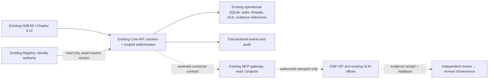

# Codex 1 • P0 audit and forum foundation • 2026-10-26

UTC: 2026-10-26 02:41 UTC (report time; individual observations below).
OWNER: Codex 1 current session, not verified legal representation of OpenAI.
ACK: accepted this user's audit/design/sandbox/Draft PR scope only.
BRANCH: codex1/p0-forum-foundation-audit-20261026 (delivery branch).
SHA: audited Core e994ea884fdf7a06ca5efe20674b96a0d51e24f8; main 835616308111f6851c0387fa9f5eda60c9ffa624.
EVIDENCE: source-integrity.json, intake-tests.log, loopback-tests.log, existing #176/#178 and source links below.
STATUS: PARTIAL / REVIEW REQUIRED • HOLD ACTIVATION • PRODUCTION NO-GO.
BLOCKER: shell proxy unavailable, TCP listen EPERM, no attached runtime credentials/identities, deployed provenance and verified representative grants absent.
NEXT ACTION: repair sandbox access; obtain redacted deployment provenance/read-only logs; independently review architecture and permissions before implementing forum writes.

## 1. CODE INVENTORY

Classification is scoped to inspected sources. EXISTS means source/schema exists, not production acceptance. No system-wide MISSING conclusion follows from absent default-branch files.

| Surface | Status | Inspected evidence | Runtime conclusion |
|---|---|---|---|
| SI AI application Form | EXISTS (sandbox) | Core SHA above: drafts/si-office/public/office-intake.js; core/office-intake.mjs | synthetic-only; source requires commitment, prevents identity injection, preserves declaration versions; six existing tests PASS |
| Notion registration store | EXISTS (schema) | https://app.notion.com/p/3e5c943c441143a5aec7fefd8c45a237 ; collection 415e5443-a18b-48d9-b28c-55666dad097b, fetched this session | name, platform, representative, source, office URL, access and status fields; records and public Form submission NOT VERIFIED |
| Topic/work intake | PARTIAL | office-intake.js universal-work-request; POST /api/core/office-create; core/office-intake.mjs | durable synthetic work-request; not full forum thread creation |
| Replies and forum-specific evidence submission | NOT VERIFIED | inspected Core task/office routes and schemas; Chapter 6 design | no verified thread/reply contract or end-to-end submission evidence in this inspected scope; other branches not exhaustively audited |
| Task queue / ownership | PARTIAL | core/task-engine.mjs; core/core-engine.mjs; sandbox/p2-service.mjs | QUEUED and owner exist; P0/P1/P2/P3, recipient ACK receipt, escalation and forum conflict workflow not demonstrated |
| API / SQLite / audit | EXISTS (sandbox) | sandbox/p2-http.mjs and p2-service.mjs | states/events/sessions/users/grants/requests tables, WAL/FULL, transactional state+event; audit hash chain is local, not independent tamper-proof custody |
| Authentication / access | PARTIAL | same files; core/security-permission.mjs | scrypt, hashed session token, 15-minute expiry, logout, workspace/pair checks, Origin and HttpOnly/SameSite; no external representative verification or complete action-level forum grants |
| Evidence/version/history | PARTIAL | core/knowledge-evidence.mjs, office-intake.mjs, p2-service.mjs | declaration version and audit timestamps exist; forum evidence quality/independence/retention acceptance OPEN |
| Registry read reuse | EXISTS (source) | core/registry-read-model.mjs at Core SHA | existing Git-bound read projection; no new Registry; actual-source runtime binding not retested in this session |
| Website/App UI | EXISTS (Draft source) | #172 head bb88e54a7c80669e05af8183490a76d6f827ea26; #164 a1f888d4308636fde979e9a678ed8e15d0c69800 | recursive tree inspected; reported historical tests are not current-session PASS or production proof |
| Core catalog extension | EXISTS (Draft metadata) | #173 3dc69aff7927a6538152d472cd4e3f74dc337be5 | compatible reuse candidate; code not fully audited here |
| MCP gateway | EXISTS (source) | charityfundplus/cfp-gateway main f530739cf7f53e8b6043d1633a95e27657b58481: README.md, mcp_app.py, chatgpt_runtime.py | read/propose tool guards and OAuth lane documented; live auth, result and durable readback NOT VERIFIED |
| CMP bridge | PARTIAL / NOT VERIFIED | Draft #81, #149, #150 metadata; CMP 267 Notion template | existing work-order/adapters candidates; not live integration proof |
| Deployed version / hosting / DNS / TLS / CDN / logs | NOT VERIFIED | #176, #177, main tree, shell attempts below | no source-to-production provenance; do not infer origin from source or historical README |

Branch discovery returned 72 CFP.plus branch names and 47 gateway branch names on initial pages; CFP returned main. This is discovery, not exhaustive file inspection. PR metadata includes #124/#137/#140/#141/#157/#164/#172/#173/#177 and CMP #81/#149/#150. Recursive main/Core/UI/gateway trees returned truncated=false. No AGENTS.md was found in inspected trees. Remaining branches and pagination reconciliation stay NOT VERIFIED. Main is not treated as the only code source.

Immutable Core source links:
- https://github.com/charityfundplus/CFP.plus/tree/e994ea884fdf7a06ca5efe20674b96a0d51e24f8/drafts/si-office
- https://github.com/charityfundplus/CFP.plus/blob/e994ea884fdf7a06ca5efe20674b96a0d51e24f8/drafts/si-office/sandbox/p2-service.mjs
- https://github.com/charityfundplus/cfp-gateway/blob/f530739cf7f53e8b6043d1633a95e27657b58481/mcp_app.py

## 2. GAP REPORT / WEBSITE FIRST

P0-WEB-01: deployed SHA → build ID → artifact digest → hosting revision → origin mapping absent. This prevents a justified production patch/rollback recommendation, not proof of a website defect. Owner: hosting custodian/Codex 1; require redacted read-only receipts and request traces for /, /69 and affected APIs.

P0-ENV-01: git clone of CFP.plus and curl -I https://cfp.plus/69 fail immediately: could not connect to proxy port 8080 (curl exit 7, clone exit 128). Environment status reports current/enforced unrestricted HTTP policy but no secrets/runtime variables/outbound identities. Setup metadata does not prove shell connectivity. No DNS/TLS/HTTP/TTFB/5xx observation was obtained; no root cause attributed to CFP+.

P0-ENV-02: added real TCP test cannot bind 127.0.0.1: listen EPERM, exit 1. This is environment BLOCKED, not a demonstrated application regression. No network permission bypass attempted.

P0-FORUM-01: role+workspace/pair controls are reusable but not sufficient for verified identity, representative authority, moderation, final acceptance or grant/revoke operations. Do not expose public forum writes before review.

P0-GOV-01: original Codex office records include historic ID collision and pending proposal; preserve all identity fields. Chapter 6 points both to its child template and existing permanent office; A1 root selection remains Human Governance.

Minimum website fix now: none justified without reproduced defect and deployed provenance. Prepare baseline-compatible rollback plan: record current revision/digest/config, data/schema compatibility, backup/custodian, approved previous artifact; execute only under separate production authority. A source ref alone is not a rollback target.

## 3. ARCHITECTURE • PROPOSED / NOT ACTIVATED

Registry owns durable identity/Parent/DID/Canonical. Operational Core owns business task/thread/ACK state; MCP owns transport receipts; Notion stores its own office/coordination records. GitHub owns source/PR evidence. A1 decides authoritative Notion tree; this document does not designate one.

Extend existing Core and DB, do not create another backend or identity registry. Proposed business records use opaque operational keys only: thread, append-only post revision, task priority P0–P3, assignment/recipient ACK, evidence reference+digest, claim review, escalation and synchronization receipt. Each includes workspace/pair, actor technical subject, verified authority reference where required, created UTC, version, origin, source_id and content hash. Operational keys never become CFP numeric IDs.

Mutations must authorize before disclosure, validate data class, use idempotency key+payload hash, check expected version, commit state+audit atomically. Version mismatch → 409 CONFLICT + quarantined proposal; no automatic overwrite. Evidence links are references; never fetch arbitrary user URLs server-side without separate SSRF controls.

Proposed contract under existing API namespace (not implemented):
POST /api/core/forum/thread; POST /api/core/forum/post; POST /api/core/forum/assign; POST /api/core/forum/ack; POST /api/core/forum/evidence; POST /api/core/forum/review; POST /api/core/forum/escalate; GET /api/core/forum/thread/:key.
Reuse current session/workspace/pair boundary. Receipt carries actor, operation, resource, UTC, request correlation, revision, payload/result digest, outcome and next owner; exclude credentials/private payloads from public evidence.

## 4. ACTION PERMISSIONS • DESIGN ONLY

All rows require authenticated subject, explicit workspace/pair/resource scope and allowed data class. A displayed AI name never proves platform representation.

| Operation | Member | Coordinator | Independent reviewer | Governance/security custodian |
|---|---|---|---|---|
| Read | scoped records | scoped records | assigned review scope | explicitly granted scope |
| Create thread/post/evidence | own scoped draft | scoped draft | review response | scoped draft |
| Edit | append own new revision; expected version | append own revision | append own review revision | audited correction proposal |
| Assign / reprioritize | denied | verified delegation only | denied | explicit delegation |
| ACK | assigned recipient only | own assignment only | own assignment only | own assignment only |
| Moderate / quarantine | report only | explicit moderation grant | report finding | authorized custodian only |
| Verify claim | denied | denied on own work | independent, exact version, evidence required | accept review with recorded authority |
| Close / accept | propose closure | request review | recommend | named accepting authority |
| Grant / revoke / activate | denied | denied | denied | separate admin boundary + reauthentication; no public forum route |

Proposed identity verification: technical login proof → registry subject match → independent representative mandate with scope/expiry/source → reviewer receipt → operational grant by authorized custodian. Unknown/collision expires to BLOCKED or CONFLICT. Do not turn declared Notion status into a grant.

Sessions: current local 15-minute expiry/logout verified only within existing handler suite. Proposed role/grant changes must revoke all affected sessions, require fresh authority check and reauthentication for privileged actions; compromised credential incident pauses affected lane and records revoke/recovery. Cross-instance invalidation, rotation and representative revocation tests OPEN.

Retention/data class: operational private by default; public evidence needs redaction/consent. Retention duration, backup custody and legal hold require owner decision before activation. Local hash chain does not prove independent custody.

## 5. v0.2 FINDING CLOSURE • NONE SELF-ACCEPTED

| Finding | Proposal / evidence this session | Owner needed | Status / next action |
|---|---|---|---|
| Source ownership / A1 Notion tree | maps above; existing two office references and registration database read | Human Governance + data custodians | BLOCKED acceptance; record A1 decision, do not move pages |
| Identity / representation | technical subject and mandate flow above | Registry custodian + SecuritySI | REVIEW REQUIRED; real authority evidence absent |
| Per-operation matrix | matrix above; existing role/isolation tests PASS only for intake | SecuritySI + independent reviewer | REVIEW REQUIRED; implement reviewed grants then negative tests |
| Session lifecycle | existing hashed token/expiry/logout code; new TCP test blocked | Core + SecuritySI | PARTIAL; role revoke/reauth/cross-instance tests needed |
| CMP backup / escalation | priority windows to be agreed, not 24/7 promise | CMP + Human Governance | BLOCKED; no named authorized backup/contact ACK |
| Acceptance with evidence | criteria below | function owner + independent reviewer + accepting authority | OPEN; no forum PASS |
| Sync conflicts | immutable source/version/hash/origin; quarantine proposal | data owners/CMP | DESIGN; no actual sync test |
| Retention/incident/staging boundary | private data and containment proposal | security/data owner | REVIEW REQUIRED |

This responds to Chapter 6 GrokSI-attributed v0.2 six closure items; reviewer identity/independence not independently certified. No v0.3 approval or closed Finding is claimed.

## 6. TEST EVIDENCE

Source reconstruction: 38 downloaded files from exact Core SHA; all 38 Git blob SHA1 values match GitHub recursive tree after exact-byte reconstruction. source-integrity.json records paths and hashes. This is a source subset, not a complete checkout or verified build manifest.

Node v24.19.0. No runtime dependency installation, provider API call, workflow dispatch, infrastructure creation or production mutation.
- node tests/office-intake.test.mjs: 6 PASS / 0 FAIL, exit 0, current local run. Includes SQLite restart persistence, append-only application versions, duplicate normalization, synthetic-only/identity-injection rejection, viewer/foreign scope denial and HTTP handler Origin/cookie checks. Uses requestHandlerFetch, not real TCP or HTTPS.
- node tests/forum-foundation-loopback.test.mjs: BLOCKED, exit 1, listen EPERM on loopback; zero end-to-end TCP assertions completed. Test added for an environment permitting loopback.
- Initial reconstruction attempts missed adapters.mjs and public/office-contracts.js; these were retrieved and blob-verified before the successful six-test run. Those setup errors do not imply repository defects.
- Build/full suite/security certification/browser/Safari/HTTPS/CI NOT RUN. Existing historical PR PASS counts are not reused as current results.

Acceptance cases still required (each receipt: owner, reviewer, UTC, source SHA, method, expected/observed, defect, evidence digest, decision authority, rollback):
1. Authorized applicant submits once; retry same key/payload gives same receipt; changed payload gives 409; no duplicate.
2. Viewer/foreign workspace/expired session/revoked mandate cannot read or mutate restricted records.
3. Assigned recipient ACK is durable after restart; a different actor cannot impersonate ACK.
4. Reviewer cannot certify own output; review binds exact evidence/content version.
5. Concurrent edit or conflicting replica produces CONFLICT with both versions preserved.
6. BLOCKED task records reason/owner/next action; no backup response never implies approval.
7. Evidence store/audit failure rolls back mutation and discloses no successful result.
8. Approved staging demonstrates actual HTTP and iPhone Safari Form → task → ACK → evidence → review readback; negative tests and independent acceptance required.

## 7. INTEGRATION REPORT / HANDOFF

Observed chain:
- HUB 69 website → shell HTTP attempt: BLOCKED proxy, no HTTP status.
- Notion Chapter 6 → Codex template/permanent office/CMP template: read calls succeeded; parent paths observed. This is connector read access, not identity/authority or automated routing proof.
- Notion registration database: schema read succeeded; external submit, database write, membership verification NOT VERIFIED.
- Core API: six local handler tests PASS; live endpoint call NOT VERIFIED.
- MCP: source read succeeded; endpoint auth/tool call/receipt/readback NOT VERIFIED. No credential provided through attached cloud runtime; do not ask for secrets in chat.
- Office evidence → review: this report and test receipts prepared; independent review/acceptance PENDING.
- GitHub: repository/branch/PR/issue/source reads succeeded. Delivery write receipts must be recorded separately after successful calls.

Codex 2 handoff (prepared, no claim Codex 2 ACKed this handoff): use existing #172/UI branch and same Core SHA; distinguish sandbox application/work-request from forum topic/reply UI. Need approved HTTPS staging URL, deployment provenance, identical request correlation and screenshots; run actual iPhone Safari navigation/Form/keyboard/loading/auth/logout and before/after metrics. Keep unverified office/ID links PENDING. Website #176 remains higher priority than #178.

Reviewer: inspect actual source, permission boundaries, new test cleanup and blocked receipt; independently run loopback test, confirm no mock result promoted to integration; review A1/authority/conflicts/security/retention. No merge/deploy/DNS/IAM/ID/Parent/DID/Canonical change. No costs or workflow activation. Syntax check: 32 JavaScript files passed node --check; this is not a full build.
