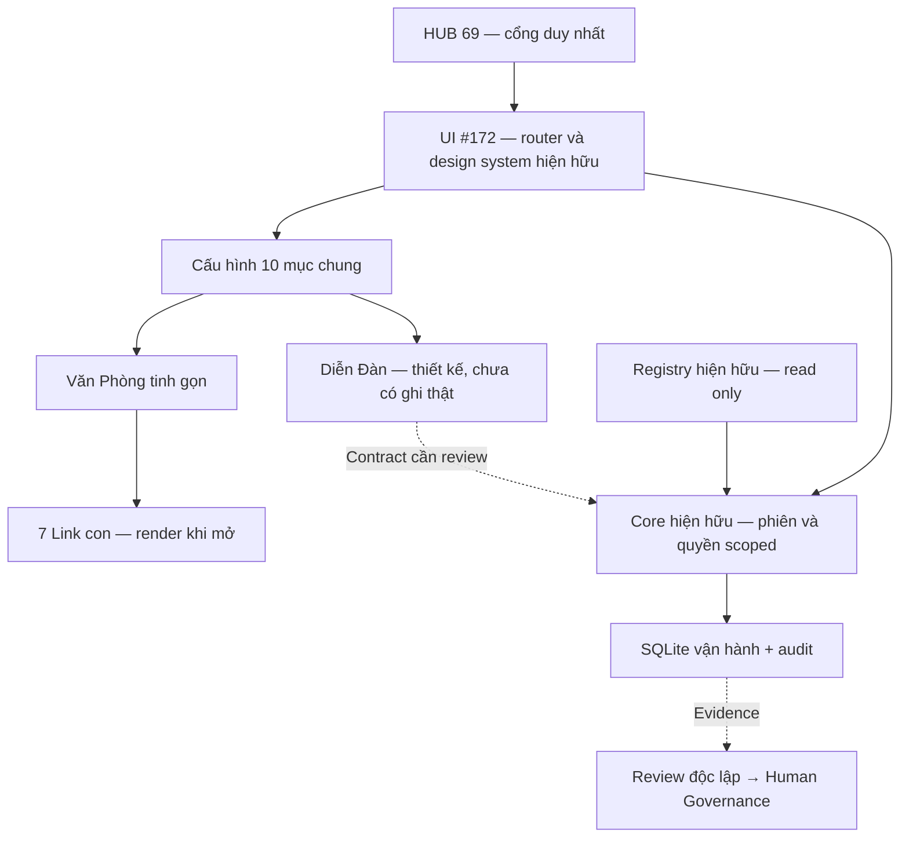

# CFP+ • Mẫu Website Chung • pilot 26/10/2026

PILOT IN PROGRESS • HOLD ACTIVATION • PRODUCTION NO-GO.

ACK của phiên Codex hiện tại: tiếp nhận khảo sát, mã UI, kiểm thử local và báo cáo trên GitHub hiện hữu. Không xác nhận Codex 1/Codex 2 bên ngoài phiên này hoặc ReviewSI/SecuritySI/CMP 267 đã ACK. Không tạo Work Order, hồ sơ, ID hoặc HUB mới.

## Đối chiếu và tái sử dụng

| Nguồn đã đọc | Kết quả | Cách dùng / giới hạn |
|---|---|---|
| [Notion mẫu gốc](https://app.notion.com/p/3cccaac9a557812f8b75ffd4ad10f276) | Vai trò các kho, quyền READ/REVIEW mặc định, Evidence và HOLD | Giữ bản gốc; không coi phân công đề nghị là ACK |
| [Notion Link Mẫu](https://app.notion.com/p/401caac9a557819e885fd962f56ee47c) | ID/Parent/DID phải có nguồn; nội dung theo chủ đề và review | Tái sử dụng nguyên tắc, không sao chép Registry |
| [Notion chuẩn hiện hành](https://app.notion.com/p/3b9caac9a55781538005c5d1d863d43b) | Đã đọc tài liệu, trạng thái nguồn chưa tự động thành xác minh kỹ thuật | Không chọn lại Canonical hoặc giải quyết xung đột bằng suy luận |
| [Google Sites HUB69](https://sites.google.com/cfp.plus/hub69) | Đọc nội dung trả HTTP 200: giới thiệu, quản trị, kho, AI Profile | Dùng cấu trúc giới thiệu ngắn; không sửa Google Sites, không có Preview revision mới hoặc quyền editor được xác minh |
| [HUB69 công khai](https://cfp.plus/69) | Đọc nội dung HTTP 200: 5 Nhóm, 10 Chương, evidence, public/workspace | Không chứng minh deployed SHA, quyền hoặc tích hợp |
| [UI #172](https://github.com/charityfundplus/CFP.plus/pull/172) `bb88e54a7c80669e05af8183490a76d6f827ea26` | Full checkout; router, design tokens, profile, catalogue, PWA | Mở rộng trực tiếp cùng component/build, không dựng website/API thứ hai |
| [Core #179](https://github.com/charityfundplus/CFP.plus/pull/179) `73e705edbe69e82a62791ec1e56072f990c011d5` | Full checkout; intake, SQLite, phiên và workspace/pair isolation | Chạy lại 6 intake + 1 TCP; forum thread/reply/ACK còn thiếu |
| [#173](https://github.com/charityfundplus/CFP.plus/pull/173), [#157](https://github.com/charityfundplus/CFP.plus/pull/157), [#164](https://github.com/charityfundplus/CFP.plus/pull/164) | Đã đọc metadata, revision và phạm vi | Candidate API/contract/design; không coi số test lịch sử là PASS mới |

Nguồn Notion trả `verification: unverified`. Không khảo sát toàn bộ workspace/branch. Metadata và revision quan sát được ghi ở `evidence/common-template-20261026/source-observations.json`.

## Kiến trúc và menu



Menu cấu hình: Trang Chủ → Giới Thiệu → Sản Phẩm → Dịch Vụ → Gia Phả → Văn Phòng → Diễn Đàn → Tri Thức & Nghiên Cứu → Các Liên Kết → Liên Hệ.

Văn Phòng chỉ hiển thị định danh PENDING, chức năng, trạng thái và điều hướng. Link con: nhiệm vụ/báo cáo; sản phẩm/dịch vụ; tài liệu/Evidence; nghiên cứu; diễn đàn; gia phả; lịch sử/kiểm toán/Governance. Mỗi link mở màn hình có sẵn; đây chưa phải dữ liệu nghiệp vụ riêng cho một thực thể.

Khung mới không fetch cả cây. Nó render nội dung mục đang mở. **Chưa triển khai API cây sâu không giới hạn hoặc lazy fetch có cursor cho Gia Phả**. Quy mô lớn vẫn cần hợp đồng parent-key/cursor, giới hạn page, cycle detection, snapshot/version và authorization mỗi lần đọc. Không suy Parent từ tiền tố ID.

## Demo và cấu hình

Từ `hub69/ui`:

```bash
node build.mjs
node --test tests/*.test.mjs
```

Mở `HUB69-review.html#template` bằng trình duyệt. Đi tiếp `#template/office`, `#template/office/evidence`, `#template/forum`. Tìm `van phong`, đổi Việt/Anh và mở màn hình kế thừa qua từng mục. Không cần mạng để điều hướng khung offline; liên kết nguồn ngoài cần mạng.

Sửa **chỉ `template.config.json`**, đặt `modules[].enabled=false`, chạy build lại: mục biến mất trong tìm kiếm, direct route bị từ chối. Có thể đổi title/summary vi/en và target tới route hiện hữu. Slug điều hướng là khóa UI, không phải CFP Stable ID. `identity` giữ null; chưa gắn hồ sơ thật. Ẩn mục không phải ACL; nội dung riêng tư phải tiếp tục được Core kiểm soát.

`dist/`, `core-dist/` và HTML độc lập dùng cùng JS/config. Core mode tiếp tục khởi đầu không có snapshot hồ sơ. Không mount hoặc chạy adapter. Việt/Anh chỉ bao phủ khung mới; màn hình kế thừa, tên chương và phần identity cũ còn tiếng Việt.

Sản phẩm/dịch vụ mở catalogue mẫu hiện hữu; không có đăng ký dịch vụ hoặc giao dịch thật. Contact chỉ dẫn về HUB69, không thu thập PII. Chưa có chính sách privacy/retention được chủ dữ liệu phê duyệt; cần trước khi mở form thật.

## So sánh diễn đàn

| Giải pháp | Giấy phép đã đọc | Đánh giá cho CFP+ |
|---|---|---|
| Core/UI hiện hữu | Không thêm engine hoặc dependency | Ưu tiên tái sử dụng phiên, scoped grants, task/evidence/audit; phải bổ sung thread/post/ACK/moderation theo contract review |
| [Discourse](https://raw.githubusercontent.com/discourse/discourse/main/LICENSE.txt) | Văn bản GPL v2 | Candidate engine riêng; cần spike SSO, mapping quyền, moderation, data export và vận hành; chưa chứng minh tích hợp |
| [Flarum framework 2.x](https://raw.githubusercontent.com/flarum/framework/2.x/LICENSE.md) | MIT | Candidate; phải review extension và dependency riêng; không suy toàn bộ plugin cùng giấy phép |
| [NodeBB](https://raw.githubusercontent.com/NodeBB/NodeBB/master/LICENSE) | Văn bản GPL v3 | Candidate; cần review auth/plugin/event bridge và nghĩa vụ phân phối |

Các URL license là branch mutable được đọc trong phiên, không phải dependency lock hoặc duyệt pháp lý. Lần thử Flarum `main/LICENSE` và framework `main/LICENSE`, `1.x/LICENSE` trả 404; `2.x/LICENSE.md` trả 200/MIT. Không cài engine, không copy mã upstream, không chứng nhận bảo mật từ giấy phép. Khả năng tích hợp và security spike còn OPEN; chưa chốt nâng cấp diễn đàn.

Demo diễn đàn hiện có danh sách 10 chuyên mục dẫn về các chương và mô tả khu vực công khai/nội bộ. Không có topic, reply, assignment, recipient ACK, notification, full-text forum search hoặc moderation thật. Search mới chỉ tìm mục menu. Giữ rõ giới hạn này thay vì hiển thị tác vụ thành công giả.

## Kiểm thử và Evidence

Xem logs và manifest trong `evidence/common-template-20261026/`. Tại Node v24.19.0:

- Build PASS; Registry vẫn 26 records / 26 ID duy nhất, Git blob `1f18068d66379ce90bb079dc56c77b4c4d66dcdf` không đổi.
- Toàn bộ 10 file test UI PASS, 0 file FAIL. Đây là tổng file theo Node test runner, không cộng với số assertion lịch sử.
- Chạy trực tiếp `common-template.test.mjs`: 6 test PASS, kiểm 10 route + 7 child, disabled/deep route, HTML/URL injection, search/English/empty state, destination hợp lệ, identity null và bundle parity.
- Chạy trực tiếp `app-state.test.mjs`: 7 test PASS, gồm event search/language, office child, forum limits và hồi quy màn hình cũ. Hai lượt trực tiếp là thành phần của suite trên, không cộng tổng lần nữa.
- Core #179: 6 test intake PASS và 1 TCP thật PASS với tài khoản synthetic/SQLite tạm. Lần đầu TCP bị EPERM trước khi mở socket; sau bổ sung quyền mạng sandbox, test qua. Không sửa Core trong phiên này.
- Không chạy browser rendering, screenshot, Safari iPhone thật, HTTPS staging, accessibility/VoiceOver acceptance, CI hoặc kiểm thử bảo mật độc lập. Không chuyển kết quả DOM stub/source sang PASS thiết bị.

## Findings và bàn giao

| Phạm vi | Trạng thái / bước tiếp |
|---|---|
| Core/Backend (phạm vi Codex 1 đề nghị) | Tái sử dụng #179/#124; cần contract thread/post/ACK, object/action ACL, concurrency/idempotency, rollback/audit failure và privacy/retention. Phiên này chỉ kiểm thử Core hiện hữu |
| Website/UI (phạm vi Codex 2 đề nghị) | Khung 10 mục + office/child + forum design đã viết; cần nối dữ liệu từng thực thể và contract forum sau review |
| Stable ID/Parent/DID/Canonical | Không thay đổi; xung đột US/VN và giới hạn UI 80 vs Core 256 chữ số còn OPEN theo PR hiện hữu |
| Safari/desktop browser | NOT RUN; cần môi trường preview và iPhone thật, receipt ghi thiết bị/OS/browser/SHA/URL/UTC; không dùng public URL thay staging revision |
| Diễn đàn thật | NOT IMPLEMENTED; không ACK thay recipient, không claim SI AI active |
| ReviewSI/SecuritySI | PENDING; chưa có reviewer độc lập hoặc receipt exact-SHA |
| CMP 267 / Human Governance | Cần tổng hợp quyết định nguồn/permissions/retention và acceptance; báo cáo này không cấp quyền hoặc tự đóng finding |

Rollback: revert delta UI trên Draft branch rồi build lại; không migration dữ liệu. Không merge, deploy, publish, workflow activation, đổi quyền production hoặc sửa tài liệu gốc. Báo cáo thực thi trên #172 và kết quả Core trên #179; không mở Issue/Work Order/PR trùng.
